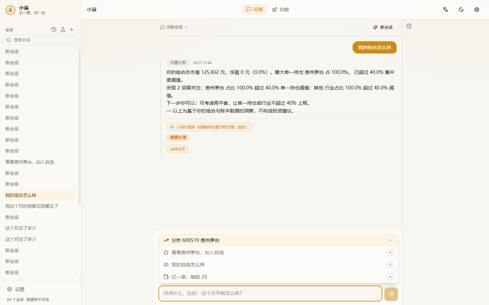
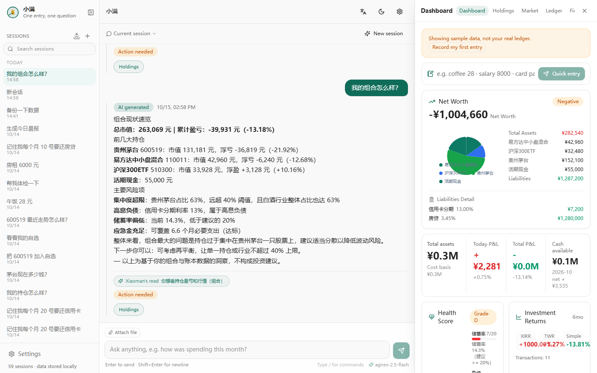
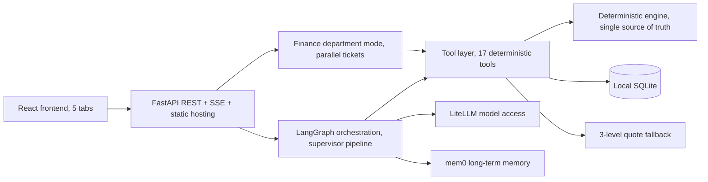

# Xiaoman

> A conversation-first personal finance assistant. One sentence to record an expense, check quotes, manage positions, run a health check, or get your morning report.


| 简体中文 | English |
|---|---|
| [README.zh.md](README.zh.md) | **README.md (current)** |

Xiaoman is one of the 24 solar terms — the moment when grain is nearly, but not yet, full. Personal finance works the same way: save a little every day and let life fill up at its own pace.

## What it is

A finance assistant that runs on your own machine, with conversation as the core interaction:

| You say | Xiaoman does |
|---|---|
| "coffee 28, taxi 32" | Records two entries in one sentence |
| "salary 1w credited" | Records income 10000 (supports 万/w/k and Chinese numerals) |
| "check CATL, add to watchlist if good" | Quote → add to watchlist → visible on Market |
| "buy 100 shares of 600519" | Opens a position at the current price (asks for cost when quotes are unavailable) |
| "sell half of 600519" | Half-position sell, never an accidental full liquidation |
| "remember I pay rent 5000 next month" | Stored in long-term memory, auto-referenced in answers |
| "generate today's morning report" | Generated and archived |

The other tabs (Overview / Holdings / Market / Ledger) are views of the conversation results, not duplicate form entries.

## Core features

- **100% local data**: everything lives in a local SQLite database. Optional passphrase-protected encrypted backups (PBKDF2 + Fernet); the passphrase is never stored.
- **Never fabricates numbers**: amounts, P&L and risk metrics are computed by a deterministic engine; the model only classifies and writes prose. At runtime the model only sees read-only tools.
- **Model-agnostic**: unified access via LiteLLM — DeepSeek / Doubao / Qwen / Claude / OpenAI / Gemini, with automatic failover. Fully usable without any model configured.
- **Multi-agent orchestration**: a LangGraph graph (supervisor pipeline), plus a "finance department mode" that splits one request into tickets, runs departments in parallel, and summarizes for approval.
- **MCP protocol**: all finance tools are exposed as a standard MCP Server via fastmcp — Claude Code / Cursor can query your local data directly.
- **Long-term memory**: mem0 handles preference extraction and updates across sessions.
- **3-level quote fallback**: Eastmoney → Sina → local snapshot, clearly labeled when offline.
- **PWA**: installable on desktop and mobile.

## Screenshots

| Chat hub | Overview |
|---|---|
|  |  |

More in [docs/screenshots/](docs/screenshots/) and [docs/demo/](docs/demo/).

## Quick start

Requirements: Python 3.10+, Node.js 18+.

**One-click (recommended)**

```bash
scripts/dev.sh        # macOS / Linux — backend 8788 + frontend 5198
start.bat             # Windows
```

**Manual**

```bash
# Backend (run inside backend/)
cd backend
python3 -m venv .venv && .venv/bin/pip install -r requirements.txt
cp .env.example .env   # optional: fill LLM_* to enable a model
.venv/bin/python -m uvicorn app.main:app --host 127.0.0.1 --port 8788

# Frontend dev mode (/api proxied to 8788)
cd frontend
npm install && npm run dev    # http://127.0.0.1:5198

# Or production mode: build once, served by the backend on one port
cd frontend && npm run build  # then open http://127.0.0.1:8788
```

**Docker**

```bash
docker compose up -d --build   # single container, port 8787, volume xiaoman-data
```

A fresh database starts empty with chat-style onboarding; everything works without an AI key.

## Tech stack

| Layer | Tech |
|---|---|
| Frontend | React 19 + Vite + Tailwind 4 · ECharts · TanStack Table · PWA |
| Backend | FastAPI + LangGraph multi-agent orchestration + deterministic engine |
| Data | SQLite (aiosqlite + WAL) · encrypted backups (PBKDF2 + Fernet) |
| AI | LiteLLM unified access · mem0 long-term memory · fastmcp |
| Quotes | Eastmoney → Sina → local snapshot, 3-level fallback |

## Architecture



Principle: **the framework orchestrates; the engine computes**. The model only appears at classification and finalization; any failure degrades to the deterministic path. Full architecture with diagrams: [docs/architecture.md](docs/architecture.md).

## Repository layout

```
backend/app/
  main.py            FastAPI entry: REST + SSE + auth + static hosting
  db/                Data layer (domain modules): ledger / portfolio / budgets /
                     debts / goals / memory / history / audit / backup / users ...
  routes/            Routes: budgets / settings / goals / market / import ...
  agents/            Multi-agent config: supervisor / bookkeeping / portfolio
  agent_graph.py     LangGraph graph: supervisor + specialized nodes + routes
  department.py      Finance department mode: tickets → parallel → summary
  analysis.py        Deterministic engine: positions / cashflow / debt / risk
  tools.py           Agent tool layer: 17 function-calling tools
  quotes.py          Quotes: Eastmoney → Sina → snapshot fallback + cache
  nlparse.py         One-sentence bookkeeping: rule engine + AI fallback
  llm.py             LiteLLM unified model access
  mem.py             mem0 long-term memory wrapper
  mcp_server.py      MCP Server exposing finance tools
  backup.py          Local encrypted backup, passphrase never stored
frontend/src/
  App.tsx            5-tab layout (top bar on desktop / bottom bar on mobile)
  components/        ChatView / Dashboard / HoldingsView / MarketView ...
  lib/               api / store / i18n (zh+en) / charts / format
docs/                Deploy / config / workflow / architecture / planning
```

## Docs

| Doc | Contents |
|---|---|
| [Quick start](docs/quickstart.md) | Up and running in 5 minutes |
| [Deployment](docs/DEPLOY.en.md) | Local / Docker / external access / backup migration ([中文](docs/DEPLOY.md)) |
| [Configuration](docs/CONFIG.en.md) | Env vars + settings + AI endpoint cheat-sheet ([中文](docs/CONFIG.md)) |
| [Workflows](docs/WORKFLOW.en.md) | Every conversation pattern ([中文](docs/WORKFLOW.md)) |
| [Architecture](docs/architecture.md) | Mermaid diagrams + department mode + data reliability |
| [Development guide](docs/DEVELOPMENT.en.md) | Code map + add-tool/setting tutorials + release flow ([中文](docs/DEVELOPMENT.md)) |
| [Roadmap](docs/ROADMAP-v3.md) | v3 direction → [detailed plan](docs/PLAN-DETAILED.md) |
| [Planning archive](docs/planning/) | Reviews / differentiation / research docs |
| [Changelog](CHANGELOG.md) | Full version history |

## Tests

```bash
# Backend: 486 tests (engine / quote fallback / agent loop / LangGraph / API / backup / MCP ...)
cd backend && .venv/bin/python -m pytest tests -q
cd backend && .venv/bin/python -m ruff check app tests

# Frontend: tsc + build + 86 unit tests + 15 Playwright e2e specs
cd frontend && npm run build
cd frontend && npm run test:e2e
```

CI covers backend ruff + pytest and frontend tsc + build.

## Data & privacy

- All personal data lives in local SQLite; quotes use public Eastmoney/Sina endpoints; model calls go only to the endpoint you configured.
- Encrypted backups recommended; plaintext export shows a strong warning. No telemetry, no tracking, no third-party analytics.
- Auth: when `API_TOKEN` is set, all `/api/*` require `Bearer` or `?token=`; without a token, only localhost and the `ALLOWED_HOSTS` allowlist are accepted.

## Disclaimer

Everything this software outputs (health checks, reports, AI answers, suggestions) is for reference only and does not constitute investment advice. Markets carry risk.

## Contributing

- License: [MIT](LICENSE) · [CONTRIBUTING.md](CONTRIBUTING.md) · [CODE_OF_CONDUCT.md](CODE_OF_CONDUCT.md) · [SECURITY.md](SECURITY.md)
- Issues and PRs welcome; please pair new features with tests and pass the test commands above before submitting.

**Topics**: `personal-finance` `finance-assistant` `ai-agent` `langgraph` `fastapi` `react` `sqlite` `local-first` `mcp` `pwa`
