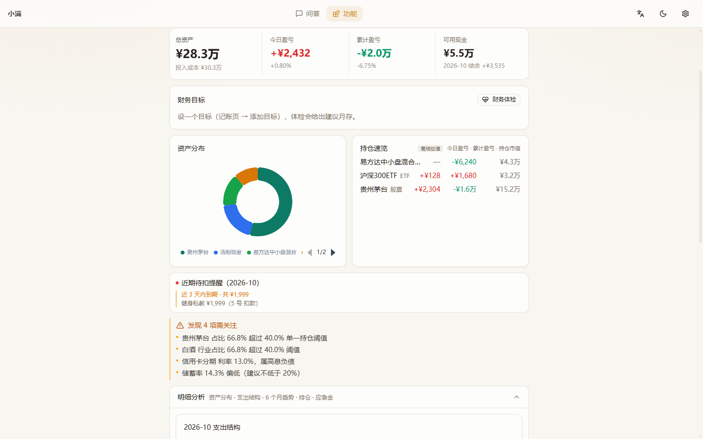
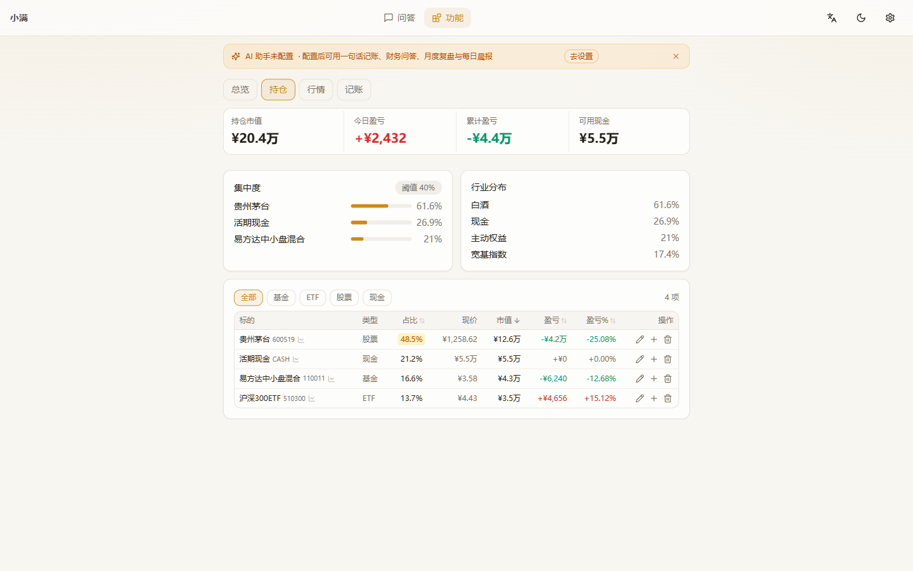
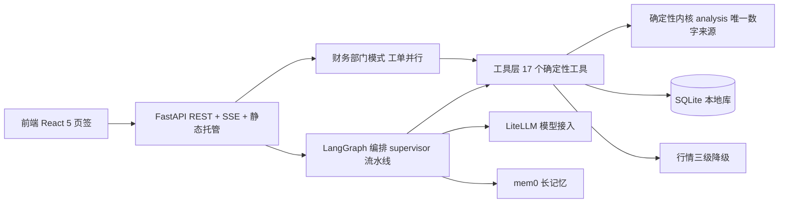

# 小满 Xiaoman

> 对话优先的个人理财助手。记一笔、问一句，记账、行情、持仓、体检、晨报都在对话里完成。


| 简体中文 | English |
|---|---|
| **README.zh.md（当前）** | [README.md](README.md) |

小满（Xiaoman）是二十四节气之一，谷物渐满而未满。理财同理：每天攒一点，日子自有分寸地饱满起来。

## 它是什么

一个跑在你自己机器上的理财助手，核心交互是对话：

| 你说 | 小满做 |
|---|---|
| 「咖啡 28，打车 32」 | 一句话记两笔账 |
| 「工资 1w 到账」 | 记收入 10000（支持 万/w/k 与中文数字） |
| 「看看宁德时代，可以就加自选」 | 查行情 → 加自选 → 行情页可见 |
| 「600519 买 100 股」 | 按现价开仓（无行情时会问成本价） |
| 「卖一半 600519」 | 半仓卖出，绝不误清仓 |
| 「记住下个月房租 5000」 | 存入长期记忆，回答时自动引用 |
| 「生成今天的晨报」 | 生成并归档晨报 |

其余页面（总览 / 持仓 / 行情 / 记账）都是对话结果的视图，不是重复的表单入口。

## 核心特性

- **数据 100% 本地**：所有财务数据只存本机 SQLite。可设口令导出加密备份（PBKDF2 + Fernet），口令不落盘。
- **数字绝编造**：金额、盈亏、风控指标全部由确定性内核计算，模型只做分类与成文。运行时模型只拿到只读工具，改不了你的数据。
- **模型随意换**：基于 LiteLLM 统一接入，DeepSeek / 豆包 / 通义千问 / Claude / OpenAI / Gemini 任选，自动故障转移。未配模型也能用，内置分析兜底。
- **多 Agent 编排**：LangGraph 图编排（supervisor → 各专项节点），另有「财务部门模式」——一句话拆成工单，四部门并行取数，秘书汇总呈批。
- **MCP 协议**：所有财务工具经 fastmcp 暴露为标准 MCP Server，Claude Code / Cursor 可直接接入你的本地财务数据。
- **长记忆**：mem0 负责偏好与家庭背景的记忆抽取与更新，跨会话生效。
- **行情三级降级**：东方财富 → 新浪 → 本地快照，全挂时用快照价并明确标注「离线估值，非实时」。
- **PWA 可安装**：桌面 / 移动端都能装成独立应用。

## 界面速览

| 对话中枢 | 总览 |
|---|---|
|  |  |

| 持仓 | 英文界面 |
|---|---|
|  |  |

更多截图见 [docs/screenshots/](docs/screenshots/)，功能演示见 [docs/demo/](docs/demo/)。

## 快速开始

要求：Python 3.10+，Node.js 18+。

**一键启动（推荐）**

```bash
scripts/dev.sh        # macOS / Linux，后端 8788 + 前端 5198
start.bat             # Windows 双击
```

**手动启动**

```bash
# 后端（必须进 backend/ 目录执行）
cd backend
python3 -m venv .venv && .venv/bin/pip install -r requirements.txt
cp .env.example .env   # 可选：填 LLM_* 启用模型，注释里有国产端点示例
.venv/bin/python -m uvicorn app.main:app --host 127.0.0.1 --port 8788

# 前端开发模式（/api 代理到 8788）
cd frontend
npm install && npm run dev    # http://127.0.0.1:5198

# 或生产模式：构建一次，后端单端口伺服
cd frontend && npm run build  # 然后打开 http://127.0.0.1:8788
```

**Docker**

```bash
docker compose up -d --build   # 单容器，端口 8787，数据卷 xiaoman-data
```

首次启动为空库，各页有对话式引导；AI 不配置也能完整使用。

## 技术栈

| 层 | 技术 |
|---|---|
| 前端 | React 19 + Vite + Tailwind 4 · ECharts · TanStack Table · PWA |
| 后端 | FastAPI + LangGraph 多 Agent 编排 + 确定性分析内核 |
| 数据 | SQLite（aiosqlite + WAL）· 加密备份（PBKDF2 + Fernet） |
| AI | LiteLLM 统一接入（OpenAI 兼容端点）· mem0 长记忆 · fastmcp |
| 行情 | 东方财富 → 新浪 → 本地快照，三级降级 |

## 架构



原则：**框架编排，内核算数**。模型只出现在分类与成文环节，任一环节失败自动降级到确定性路径，服务不中断、数字不出错。完整架构说明与四张 Mermaid 图见 [docs/architecture.md](docs/architecture.md)。

## 仓库结构

```
backend/app/
  main.py            FastAPI 入口：REST + SSE + 鉴权 + 静态托管
  db/                数据层（域模块包）：ledger / portfolio / budgets / debts /
                     goals / memory / history / audit / backup / users / family …
  routes/            路由层：budgets / settings / goals / market / import …
  agents/            多 Agent 配置：supervisor / bookkeeping / portfolio
  agent_graph.py     LangGraph 图：supervisor + 专项节点 + 条件路由
  department.py      财务部门模式：工单分解 → 并行取数 → 秘书汇总
  analysis.py        确定性内核：持仓 / 现金流 / 负债 / 集中度 / 风控
  tools.py           Agent 工具层：17 个 function-calling 工具
  quotes.py          行情：东财→新浪→快照 三级降级 + 统一缓存
  nlparse.py         一句话记账：规则引擎 + AI 兜底
  llm.py             LiteLLM 统一模型接入
  mem.py             mem0 长记忆封装
  mcp_server.py      MCP Server：财务工具标准化暴露
  backup.py          本地加密备份：口令不落盘
  vault.py / auth.py / scheduler.py / observability.py …
frontend/src/
  App.tsx            5 页签布局（桌面顶栏 / 移动底栏）
  components/        ChatView / Dashboard / HoldingsView / MarketView /
                     EntryView / SettingsView / AgentPanel …
  lib/               api / store / i18n（中英）/ charts / format
docs/                部署 / 配置 / 工作流 / 架构 / 规划文档（见下）
```

## 文档

| 文档 | 内容 |
|---|---|
| [快速上手](docs/quickstart.md) | 5 分钟跑起来 |
| [部署指南](docs/DEPLOY.md) | 本地 / Docker / 外网访问 / 备份迁移（[英](docs/DEPLOY.en.md)） |
| [配置参考](docs/CONFIG.md) | 环境变量 + 设置项 + AI 端点速查（[英](docs/CONFIG.en.md)） |
| [对话工作流](docs/WORKFLOW.md) | 全部一句话玩法（[英](docs/WORKFLOW.en.md)） |
| [架构说明](docs/architecture.md) | 系统架构 Mermaid 图 + 部门模式 + 数据可靠性 |
| [开发指南](docs/DEVELOPMENT.md) | 代码地图 + 加工具/加设置教程 + 发布流程（[英](docs/DEVELOPMENT.en.md)） |
| [路线图](docs/ROADMAP-v3.md) | v3 方向 → [详细计划](docs/PLAN-DETAILED.md) |
| [规划归档](docs/planning/) | 审查报告 / 差异化分析 / 调研等十份文档 |
| [变更日志](CHANGELOG.md) | 完整版本历史 |

## 测试

```bash
# 后端：486 个测试（内核 / 行情降级 / Agent 循环 / LangGraph / API / 备份往返 / MCP …）
cd backend && .venv/bin/python -m pytest tests -q
cd backend && .venv/bin/python -m ruff check app tests

# 前端：tsc + 构建 + 86 个单测 + 15 项 Playwright e2e
cd frontend && npm run build
cd frontend && npm run test:e2e
```

CI 覆盖后端 ruff + pytest、前端 tsc + build。

## 数据与隐私

- 个人数据只存本机 SQLite；行情走东财 / 新浪公开接口；模型调用只发往你自己配置的端点。
- 推荐带口令加密备份；明文导出会强提示。无遥测、无埋点、无第三方统计。
- 鉴权：设置 `API_TOKEN` 后所有 `/api/*` 要求 Bearer 或 `?token=`；未设 token 时仅允许本机与 `ALLOWED_HOSTS` 白名单访问。

## 免责声明

本软件输出的全部内容（财务体检、晨报、AI 回答、目标与预算建议）仅供参考，不构成投资建议。市场有风险，投资需谨慎。

## 参与贡献

- 协议：[MIT](LICENSE) · 贡献指引：[CONTRIBUTING.md](CONTRIBUTING.md) · 行为准则：[CODE_OF_CONDUCT.md](CODE_OF_CONDUCT.md) · 安全说明：[SECURITY.md](SECURITY.md)
- 欢迎 Issue 与 PR；新功能请配套测试，提交前过一遍上面的测试命令。

**Topics**：`personal-finance` `finance-assistant` `ai-agent` `langgraph` `fastapi` `react` `sqlite` `local-first` `mcp` `pwa` `记账` `开源理财`
